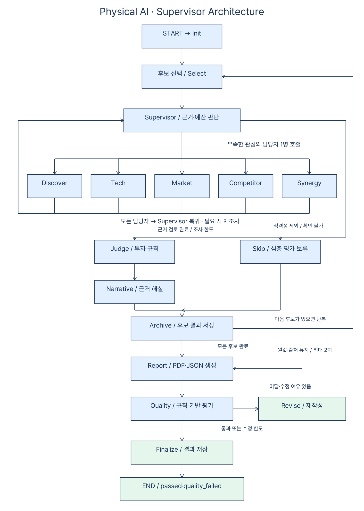

# Physical AI 스타트업 평가 — Supervisor


## Subject
본 프로젝트는 Physical AI의 소프트웨어·하드웨어 기술을 선정하여, 기술·시장·이해관계자·도메인 적용 관점에서 비교 평가하는 **Supervisor 패턴 기반 Multi-Agent RAG 시스템**입니다. 에너지·화학·배터리 제조기업의 CVC 관점에서 공개 자료를 조사하고, 근거와 미확인 항목을 포함한 PDF/JSON 보고서를 생성합니다.

## Overview
- **목적**: 선정 기술을 기술·시장·이해관계자·도메인 적용이라는 공통 관점에서 비교하고, 공개 문서의 원값과 출처로 평가 근거를 제시합니다.
- **Pattern** : Supervisor — 후보마다 부족한 근거가 달라 기존 담당 에이전트를 유지하면서 필요한 관점만 재조사하도록 선택했습니다. 필수 지표·출처·호출 예산에 따른 규칙으로 판단을 재현하고 라우팅 이유를 기록합니다.
- **동적 처리** : 고정된 에이전트 순서를 따르지 않고 현재 State의 부족 근거에 따라 다음 담당자와 재조사를 결정합니다. 적격성 확인 뒤 미수행 관점을 우선 조사하고, 같은 조건에서는 미확인 필수 지표가 많은 담당자를 선택합니다. 부족한 지표와 사유를 전달해 재작업하며 모든 담당자는 Supervisor로 복귀합니다.
- **출력**: 후보별 투자 규칙 결과, 미확인 항목, SUMMARY·네 관점·REFERENCE를 포함한 보고서와 실행 추적을 남깁니다. 기본 `stage-benchmark` 모드에서는 투자 단계 밖의 정상 비상장사도 비교하되 투자 점수와 구분합니다.

설계 근거와 구현 위치는 [설계 문서](docs/supervisor/design.md)에 정리했습니다. 현재 `main`은 Supervisor를 사용하며 이전 흐름은 `--workflow legacy`로 실행합니다.

## Selected Technologies
- **SW** : VLA 기반 조작 지능(Figure AI) — 시각·언어 정보가 로봇 작업 수행으로 연결되는 조작 지능 관점을 검토하기 위해 선정했습니다. 평가 시스템은 LangGraph Supervisor로 필요한 조사만 배정하고, FAISS·BM25 Hybrid RAG로 공개 문서 근거를 검색합니다.
- **HW** : 로봇 손·그리퍼(에이로봇), 힘·촉각 센서(에이딘로보틱스) — 제조 작업의 물리적 조작과 접촉 피드백 관점을 검토하기 위해 선정했습니다. HW는 공개 자료의 평가 대상이며, 이 프로젝트에서 실물 장비를 직접 제어하거나 시험하지는 않습니다.

이 프로젝트의 평가 후보는 정밀 조작 Physical AI의 **구동부·센서·조작 지능**을 비교하도록 구성했습니다. 후보 분류는 [후보 설정](data/candidates.json)에 근거하며 선정 목적은 다음과 같습니다.

| 평가 후보 | 기술 영역 | 선정 이유 |
|---|---|---|
| 에이로봇 | 로봇 손·그리퍼 | 제조 작업의 물리적 조작을 담당하는 구동부 관점 검토 |
| 에이딘로보틱스 | 힘·촉각 센서 | 접촉 힘과 피드백을 다루는 센서 관점 검토 |
| Figure AI | VLA 기반 조작 지능 | 조작 지능 관점과 Series C의 투자 단계 제외·비교 분석 분기 검증 |

후보 선정은 기술 우수성이나 투자 추천을 뜻하지 않습니다. 저장된 운영 결과는 에이로봇 HOLD 42.0, 에이딘로보틱스 HOLD 45.3, Figure AI HOLD·비교 점수 33.3입니다. 초기 단계 비교 점수는 투자 판정에 사용하지 않습니다. [결과와 한계](docs/supervisor/validation.md)

## Features
- **PDF 정보 추출**: 페이지 단위 파싱, 450-token chunk·60-token overlap, 후보·문서 유형 필터로 검색하고 원문 페이지와 `source_id`를 보존합니다. 미등록 출처를 인용한 LLM 주장은 폐기합니다.
- **근거 기반 재조사**: 기간·단위·분모·출처를 검증하고 부족한 지표의 담당자에게 보완 요청을 전달합니다. 자료 없음과 검증된 0건을 구분합니다.
- **보고서 품질 평가**: 인용 연결, 네 관점, 중립적 표현, 발행기관 다양성, 불리한 근거·미확인 항목, 파일 무결성·10페이지 상한을 규칙으로 검사합니다. 미달 시 원값과 출처로 최대 2회 재작성합니다.
- **확증 편향 방지 전략**: 발행기관 다양성과 불리한 근거를 검사하고 추천 표현을 제한합니다. 다른 담당자의 결과는 Supervisor가 명시적으로 전달한 경우에만 읽습니다. 근거 부족은 HOLD로 남기며, 재작성으로 부족한 출처가 확보됐다고 처리하지 않습니다.
- **재현과 복구**: 같은 평가일·규칙으로 점수를 계산하고 실행 ID·판단 사유를 기록합니다. SQLite 체크포인트와 `--resume`으로 중단한 실행을 재개합니다.

규칙 검사는 문장과 원문의 의미적 일치나 간접적인 편향까지 보장하지 않으므로 사람이 추가 검토할 한계와 미확인 사항을 표시합니다.

## Tech Stack
| 영역 | 구체 값 |
|---|---|
| Framework / Schema | Python 3.11+, LangGraph 1.x, Pydantic 2 |
| LLM / Generator | OpenAI Responses API, 기본 `gpt-4o-mini` — `--llm-model` 또는 `OPENAI_MODEL`로 변경 가능 |
| LLM / Judge | 규칙 기반 Python 평가, LLM Judge 미사용 — 투자 점수·Gate와 보고서 품질을 각각 평가 |
| VectorDB / Vector Store | 로컬 FAISS `IndexFlatIP`, 정규화 벡터의 cosine similarity |
| Embedding | `BAAI/bge-m3`, 로컬 다국어 Dense 임베딩 |
| Retrieval | Kiwi BM25 Top20 + Dense Top20 → RRF (`k=60`) → Top5 |
| Retrieval Metrics | **Hit Rate@5 1.0000, MRR@5 0.7442** — 2026-09-30, 40문항, 기존 14문서·161페이지 기준 |
| Observability / Persistence | LangSmith, JSONL 실행 로그, SQLite 체크포인트 |
| Report | Jinja2 + PyMuPDF, PDF/JSON; 제출 보고서 Pretendard |

모델 기본값은 [LLM 구현](llm/openai_responses.py), 검색 수치는 [실제 평가 JSON](evaluation/results/investment_corpus_40.json)에 근거합니다. 현재 확장 자료는 17문서·200페이지이며, 위 수치는 확장 인덱스의 재측정 결과가 아닙니다. 확장 자료의 추가 검색 확인은 [별도 검증 기록](docs/supervisor/evidence/expanded-retrieval-check.json)에 있습니다.

## Agents
| Agent / Node | 역할 |
|---|---|
| Supervisor | 적격성·부족 근거·남은 예산으로 다음 담당자와 재조사 요청 결정 |
| Discover | 법인·투자·재무·고용 원값과 적격성 근거 확인 |
| Tech | 기술 문서 검색, 연구·실물 수행·현장 실증과 기술 설명 추출 |
| Market | 공식 로봇시장 통계와 시장 성장 근거 분석 |
| Competitor | 경쟁 제품과 유효 등록 특허 패밀리 검토 |
| Synergy | 후보 수행 작업과 모기업 제조 수요·현장 인증 연결 |
| Judge | 원값을 정규화해 Gate·점수·HOLD/INVEST 계산 |
| Narrative | 확정된 점수·판정을 유지하며 출처 기반 해설 작성 |
| Report / Quality / Revise | 보고서 생성, 규칙 기반 품질 검사, 피드백에 따른 재작성 |

보고서의 네 관점은 다음과 같이 연결됩니다.

| 평가 관점 | 주요 담당자 | 검토 내용 |
|---|---|---|
| 기술 | Tech | 연구, 실물 수행, 현장 실증과 기술 성숙도 |
| 시장 | Market | 시장 규모와 성장 근거 |
| 이해관계자 | Discover · Competitor | 기업·투자 상태, 경쟁 제품과 특허 |
| 도메인 적용 | Synergy | 모기업 제조 수요, 수행 작업과 현장 인증 |

## State Schema
[SupervisorGraphState](schemas/supervisor.py)는 기존 [GraphState](schemas/state.py)를 확장합니다.

- **제어 vs 페이로드 분리** : `supervisor`, `policy`, `report_revision`, `completion_status`는 제어 정보; 분석 결과, `evaluations`, `sources`, `draft`는 작업 결과입니다. 담당자의 제어 필드 반환은 계약 위반으로 처리합니다.
- **관측성 위치** : 현재 후보 판단은 `SupervisorControl.decisions`, 완료 후보는 `routing_history`, 품질 이력은 `quality_history`에 저장합니다. 실제 노드 순서와 사유는 외부 `events.jsonl`과 LangSmith에 기록합니다.
- **지속성 비용** : PDF 원문·검색 벡터는 State 밖의 파일·인덱스에서 관리합니다. 후보 최대 3개, 출처 기본 300개 상한과 ID 병합으로 크기를 제한합니다. 초안은 최신본만 State에, 이전 PDF/JSON은 파일에 보존합니다.
- **상관** : `RunConfig.run_id`를 업무 ID와 SQLite `thread_id`로 사용합니다. `run.json`·`events.jsonl`에 LangSmith `trace_id`를 연결합니다. 재개 시 업무 ID는 유지하고 새 trace ID를 기록합니다.
- **재개/복구** : 노드 이후 State와 다음 노드를 SQLite에 저장하고 `--resume --run-id`로 복원합니다. 담당자 예외 유형을 기록하고 유효한 이전 결과를 유지하며 남은 예산 안에서 재시도합니다. 외부 API 호출 도중 중단되면 해당 호출이 다시 실행될 수 있습니다.
- **동시 처리** : Supervisor는 담당자 하나씩 호출합니다. `sources`는 동일 ID·동일 기록을 중복 제거하고 충돌은 거부합니다. `evaluations`는 후보 ID별 최신 결과로 교체하며 제어 상태는 단일 노드가 갱신합니다.
- **종료 보장** : 기본 담당자별 최대 2회, 후보별 최대 15회, 보고서 수정 최대 2회입니다. 근거 부족으로 예산 소진 시 `evidence_exhausted`·HOLD, 품질 미달이 지속되면 `quality_failed`·종료 코드 2로 끝냅니다. 한도 도달을 통과로 처리하지 않습니다.

## Architecture


담당자 반환·재조사와 후보 순환, 품질 재작성 루프를 포함한 실행 구조입니다. [상세 Mermaid 그래프와 설계](docs/supervisor/design.md#architecture-상세-그래프), [PNG 생성 소스](docs/supervisor/render_architecture.py)

## Directory Structure
```text
physical_agent/
├── agents/                 # 담당 에이전트와 Supervisor 입력·출력 계약
├── graph/                  # Supervisor·legacy 그래프, reducer, SQLite 저장
├── nodes/                  # 라우팅, 투자 Judge, 보고서 품질·수정 제어
├── schemas/                # State·지표·출처·평가·보고서 스키마
├── llm/                    # OpenAI Responses API 호출
├── rag/                    # PDF 파싱, chunking, FAISS·BM25·RRF 검색
├── data/
│   ├── candidates.json     # 확정 후보 3개
│   ├── evidence/           # 기업·시장·특허·모기업 구조화 근거
│   └── rag/                # manifest, 공개 PDF, 로컬 검색 인덱스
├── prompts/                # 근거 추출·해설 프롬프트
├── evaluation/             # 검색 평가셋과 측정 결과
├── reporting/              # 보고서 템플릿·PDF/JSON 생성·Pretendard
├── artifacts/<run-id>/     # 실행 출력: 보고서·로그·SQLite (outputs 역할)
├── docs/supervisor/        # 설계·검증·실행 안내
│   ├── evidence/           # 검증 결과와 별도 트레이싱 PNG
│   └── submission/         # 최종 PDF·DOCX·ZIP
├── scripts/                # 자료 준비, 검증, 제출 보고서 생성
├── tests/                  # 자동 테스트
├── app.py                  # 실행 진입점
└── requirements.txt
```

## Usage
Python 3.11 이상이 필요하며, 아래 명령은 저장소 루트에서 실행합니다.

```bash
python3.11 -m venv .venv
source .venv/bin/activate
python -m pip install -r requirements.txt
cp .env.example .env
```

`.env`에 `OPENAI_API_KEY`를 설정합니다. 기본 생성 모델은 `gpt-4o-mini`이며 `OPENAI_MODEL` 또는 `--llm-model`로 변경할 수 있습니다. LangSmith 추적을 사용하려면 `LANGSMITH_API_KEY`, `LANGSMITH_TRACING=true`, `LANGSMITH_PROJECT`를 설정합니다.

공개 문서를 준비하고 검색 인덱스를 생성한 뒤 실행합니다.

```bash
python -m scripts.prepare_corpus --manifest data/rag/manifest.expanded.csv
python -m rag.cli index --manifest data/rag/manifest.expanded.csv --index-dir data/rag/index-expanded
python app.py --run-id supervisor-demo --evaluation-date 2026-10-13
```

자료 준비 과정은 manifest의 SHA256으로 원문을 검증합니다. 웹페이지에서 저장한 PDF 등 자동 복원이 불가능한 자료는 원본 파일을 복원해야 합니다. 자세한 준비 조건은 [사용 안내](docs/supervisor/usage.md#rag와-llm을-포함한-실행)를 확인합니다.

API와 검색 인덱스 없이 저장된 구조화 자료로 전체 흐름을 확인하려면 다음 명령을 실행합니다.

```bash
python app.py --skip-rag --skip-llm --run-id offline-demo --evaluation-date 2026-10-13
```

이 모드는 그래프와 보고서 생성 흐름을 확인하는 용도이며, 실제 LLM·검색 성능 측정은 포함하지 않습니다.

실행 결과는 `artifacts/<run-id>/`에 저장됩니다. `report.rN.pdf`와 `report.rN.json`은 회차별 보고서, `quality.json`은 품질 평가, `run.json`과 `events.jsonl`은 실행·라우팅 기록, `checkpoints.sqlite`는 재개용 State입니다. 새 실행마다 고유한 `--run-id`를 사용합니다.

중단한 실행은 원래 실행과 같은 RAG·LLM·적격성 모드로 재개합니다.

```bash
python app.py --resume --run-id supervisor-demo
# 오프라인 실행 재개
python app.py --resume --skip-rag --skip-llm --run-id offline-demo
```

보고서 품질 통과 시 종료 코드는 `0`, 재작성 한도 이후에도 미달이면 `2`입니다. 기본 `stage-benchmark`는 투자 단계 밖의 후보도 비교 분석하며, 적격성 탈락 후보의 후속 분석을 생략하려면 `--eligibility-mode strict`를 지정합니다. 기존 고정 흐름은 `--workflow legacy`로 실행할 수 있습니다.

테스트와 제출 자료에 관한 자세한 명령은 [사용 안내](docs/supervisor/usage.md)에 정리했습니다.

## Contributors
- **조승현** : 도메인·투자평가 기준, Agent·State·Graph·보고서 설계, Supervisor 선정 근거
- **김낙근** : 공통 RAG, PDF 파싱·임베딩·검색, 출처 관리·검색 평가
- **김도현** : LangGraph·State·Supervisor 라우팅, 근거·품질 평가, Judge·통합·README 취합
- **박세진** : Discover·Market·Competitor, 기업·시장·재무·경쟁·특허 근거 수집
- **김진형** : Tech·Synergy·Report, LLM 근거 추출, 보고서 재작성·PDF 출력

실행·환경변수·테스트·제출 파일은 [사용 안내](docs/supervisor/usage.md), 상세 역할과 브랜치 운영은 [팀 작업 절차](docs/supervisor/team_workflow.md), 실제 검증은 [검증 기록](docs/supervisor/validation.md), 웹 트레이싱 사진은 [캡처 안내](docs/supervisor/langsmith_capture.md)에서 확인할 수 있습니다.
