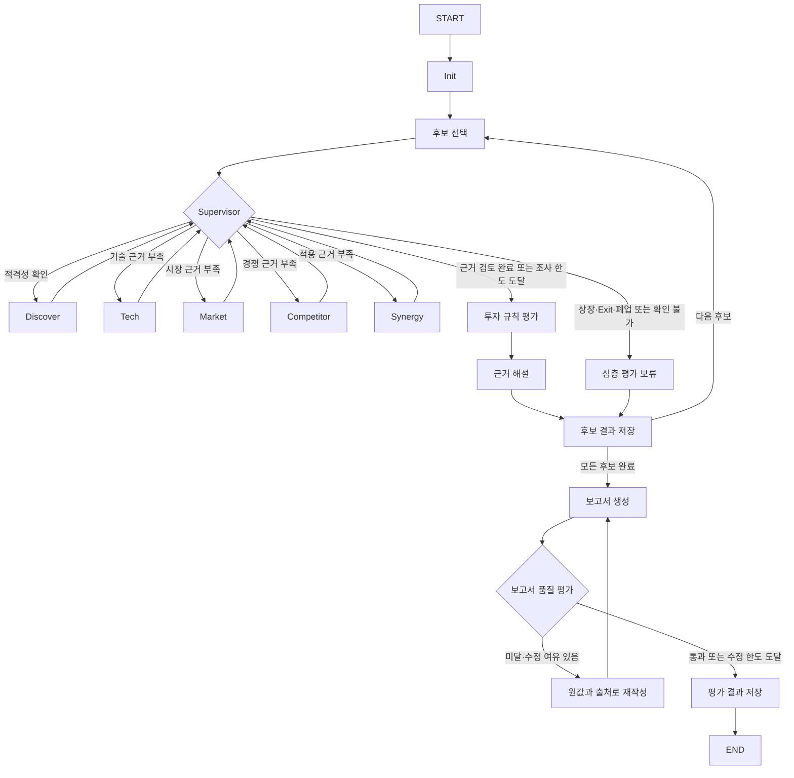

# Supervisor 설계

## 선택 근거

후보에 따라 기술 성숙도, 시장 통계, 모기업 적용 근거의 부족한 부분이 다릅니다. 기존 담당 에이전트를 유지하면서 부족한 관점을 반복 조사하는 방식이 적합하여 Supervisor를 선택했습니다. 작업을 먼저 계획하고 여러 Worker로 나누는 Orchestrator-Workers는 이번 구현에 사용하지 않습니다.

Supervisor는 LLM이 다음 노드를 추측하게 하지 않고, 필수 지표와 출처 검증 결과를 기준으로 판단합니다. 동일한 State에서 동일한 결정을 재현할 수 있고 판단 이유를 추적할 수 있기 때문입니다. 하위 Tech·Synergy의 근거 추출과 Narrative의 해설에는 기존 LLM을 사용합니다.

## 요구사항 대응

| 요구사항 | 구현 |
|---|---|
| 하위 담당자 간 직접 통신 금지 | `agents/supervised.py`에서 전체 State를 전달하지 않습니다. 자기 결과와 Supervisor의 할당 요청을 바탕으로 입력을 구성합니다. |
| 현재 State에 따른 동적 분기 | `nodes/supervisor.py`에서 적격성, 미수행 관점, 미확인 지표 수, 남은 호출 예산으로 담당자를 선택합니다. `graph/supervisor.py`의 `add_conditional_edges`로 이동합니다. |
| 근거 충분성 평가 후 보고서 작성 | Supervisor가 필수 지표의 원값·출처·기간·조건을 검사합니다. 모든 후보의 평가와 종료 사유를 저장한 뒤 보고서를 생성합니다. |
| 근거 부족 시 해당 담당자 재작업 | `Assignment`에 담당자, 지표 ID와 사유를 담습니다. 담당자별 호출 횟수를 기록합니다. |
| 품질 평가와 Loop | `report → quality → revise_report → report`로 연결합니다. 수정 상한 도달 시 실패 상태로 종료합니다. |
| 관측성 | State의 결정 이력, 외부 JSONL, LangSmith 실행에 같은 run ID를 연결합니다. |
| 필수 출력 | PDF에 SUMMARY와 REFERENCE를 포함하고 네 관점을 구분합니다. |

## State의 일곱 가지 설계 항목

1. **제어와 작업 결과의 분리**: `supervisor`, `policy`, `report_revision`, `completion_status`는 제어 정보입니다. 기존 분석 결과, `evaluations`, `sources`, `draft`는 작업 결과입니다. 담당 에이전트가 제어 필드를 반환하면 계약 위반으로 처리합니다.
2. **관측성 위치**: 최근 후보의 의사결정은 `SupervisorControl.decisions`에 기록합니다. 완료 후보의 결정은 `routing_history`에 저장합니다. 호출 순서와 판단 근거는 외부 `events.jsonl`에도 기록합니다. 보고서 품질 이력은 `quality_history`에 저장합니다.
3. **지속성 비용**: PDF 원문과 벡터를 State에 넣지 않습니다. 출처는 ID로 병합하며 실행당 300개를 기본 상한으로 둡니다. 후보는 최대 3개이며 담당자 호출은 기본 최대 2회입니다. 보고서 초안은 최신본만 State에 저장하고 PDF·JSON의 이전 버전은 파일로 보존합니다.
4. **로그 연결**: 업무 실행 ID는 `RunConfig.run_id`이며 SQLite의 thread ID로도 사용합니다. LangSmith 루트 trace ID는 실행마다 별도로 기록합니다. 재개 시 같은 업무 ID와 새로운 추적 ID가 연결됩니다.
5. **재개와 복구**: SQLite에 각 노드 이후 상태를 저장합니다. 재개 시 초기화를 다시 호출하지 않고 저장된 다음 노드부터 진행합니다. 담당자 예외는 유형을 기록하고 이전의 유효한 결과를 유지합니다. 이전 결과가 없으면 명시적인 자료 없음 상태를 만듭니다. 프로세스가 외부 API 호출 도중 종료되면 해당 호출은 다시 실행될 수 있습니다.
6. **동시 처리**: Supervisor는 한 번에 담당자 하나를 호출합니다. `sources`는 동일 ID의 동일 기록을 중복 없이 병합하고 서로 다른 기록의 충돌은 거부합니다. `evaluations`는 후보 ID별 최신 평가로 교체합니다. 제어 상태는 단일 노드가 갱신합니다.
7. **종료 보장**: 담당자별 호출 상한, 후보별 총 호출 상한, 보고서 수정 상한을 별도로 둡니다. 기본값은 각각 2회, 15회, 2회입니다. 근거가 충분하면 한도 전에 종료합니다. 근거가 부족한 채 한도에 도달하면 HOLD와 미확인 사유를 기록합니다. 보고서 품질은 한도에 도달했다는 이유로 통과시키지 않습니다.

## 네 관점의 매핑

| 관점 | 기존 지표 | 검토 내용 |
|---|---|---|
| 기술 성숙도 | T2, K1, K2, K3 | 연구 근거, 실물 수행 결과, 현장 실증을 확인합니다. |
| 시장성 | P1, R1, R2, R3, M1 | 시장 성장, 투자·연구비·고용, 특허 근거를 확인합니다. |
| 이해관계자 | T1, F1, F2, F3 | 핵심 인력, 자금 지속성, 재무와 제재 위험을 확인합니다. |
| 도메인 적용 | S1, S2, F4 | 실제 작업 수행, 모기업 수요, 현장 필수 인증을 확인합니다. |

적격성에서 제외된 후보도 네 관점을 표시하되, 해당 관점의 결론을 내리지 않았음을 명시합니다. 기존 투자 점수와 기술 추천은 구분합니다. 확인되지 않은 수치와 기업의 자체 주장을 독립적으로 검증된 사실로 표시하지 않습니다.

## 보고서 평가와 보완 범위

규칙 기반 평가를 선택했습니다. Groundedness는 인용 ID의 등록 여부, 지표와 인용의 연결, 본문과 REFERENCE의 일치를 검사합니다. 중립성은 명시적인 기술 우열·추천 표현을 검사합니다. 편향은 후보별 발행기관 다양성과 자체 발표·미확인 항목의 한계 표시를 검사합니다. 네 관점은 후보별 섹션과 지표를 대조합니다.

수정 단계는 투자 점수나 원값을 바꾸지 않습니다. 최초 LLM 해설에 문제가 있으면 저장된 지표와 출처를 기준으로 다시 작성합니다. 새로운 원문이 필요한 발행기관 부족은 문장 수정으로 해결되었다고 간주하지 않습니다. 이 경우 두 번의 수정 이후에도 `quality_failed`로 남습니다.

형식 검사만으로 문장과 원문의 의미적 일치, 출처의 신뢰도, 간접적인 편향까지 보장할 수는 없습니다. 이는 선택한 평가 방식의 한계이며, 제출 보고서 검토 시 확인해야 합니다.

## 채점 입력과 기술 설명의 보존

담당 에이전트의 원값 형식과 Judge의 입력 형식을 맞췄습니다. T1의 qualified_count, P1의 cagr_percent, M1의 unique_priority_families를 직접 읽습니다. R1은 KRW의 개별 라운드 금액을 중복 없이 합산하고 누적 발표를 제외합니다. R3는 동일한 법인의 동일 범위에서 이전·최근 인원으로 증가율을 계산합니다. 작은 기준 인원의 점수 상한도 적용합니다. F1·F2·F3는 기존 재무와 사건 수 원값으로 위험 규칙을 계산합니다. 계산에 사용한 값은 evaluation.metadata.scoring_values에 저장합니다.

제품 설명은 TechnicalFinding의 문장과 출처로 별도 보존합니다. Supervisor는 이를 평가 기록으로 전달하며, 기술 관점 보고서에 표시합니다. 논문 DOI, 시험 분모, 독립 현장 확인을 확보하지 못한 경우에도 제품 설명 자체를 삭제하지 않습니다. 제품 소개를 논문 수나 검증된 성공률로 전환하지는 않습니다.

## 투자 단계 제외 후보의 비교 분석

기본 실행 모드는 stage-benchmark입니다. 기본 요건이 비상장·Exit 미완료·정상 영업으로 확인되고 투자 단계만 Series C 이상인 후보는 분석을 진행합니다. G1은 미통과 상태로 유지하며 total_score는 None입니다. 같은 지표의 계산값은 benchmark_score에 별도 저장하고 HOLD로 표시합니다. 상장·휴폐업·Exit 완료·적격성 미확인 후보는 이 예외에 포함하지 않습니다. strict 모드는 기존처럼 단계 제외 후보의 심층 분석을 생략합니다.

초기 단계 비교 기준은 early-stage-v2로 표시합니다. 정량 사양·실물 센서 시험·공개 시연의 증거와 출처가 연결된 경우에만 해당 기술 항목을 2/5점까지 인정합니다. 기존 기준 점수는 유지하고 초기 단계 비교 점수와 변경 사유를 함께 저장합니다. INVEST/HOLD는 기존 투자 기준과 근거 충분성으로 판단합니다.

## Architecture 상세 그래프

